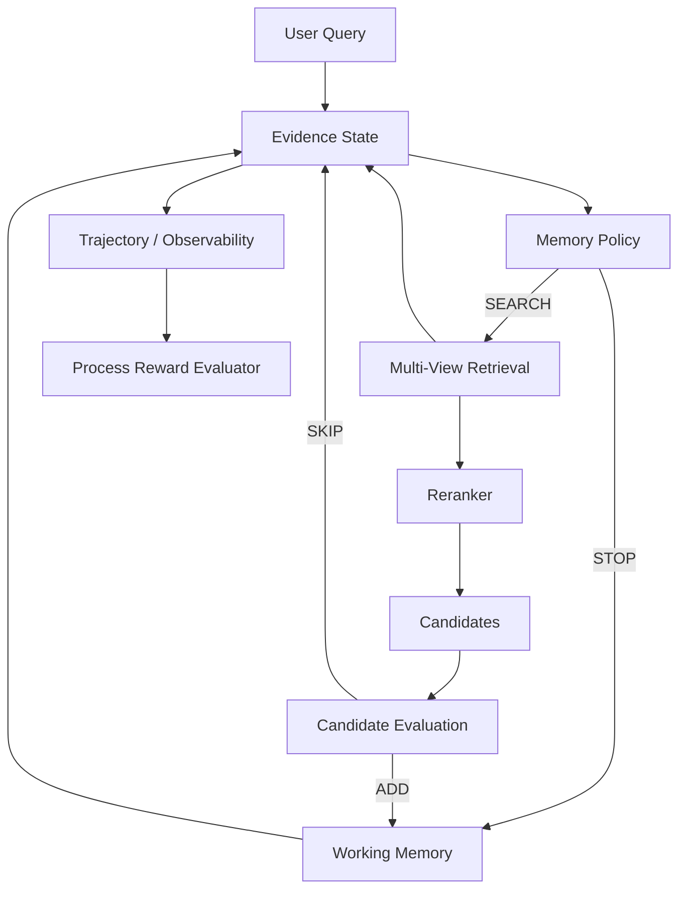
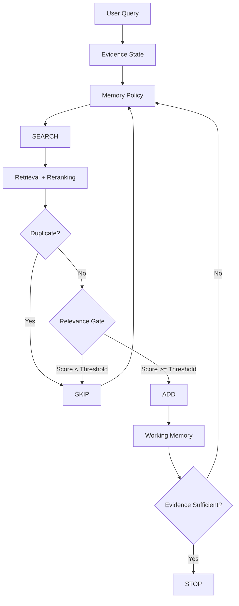

# 🧠 AI Memory Server — Long-term Memory for AI Agents via MCP

A model-agnostic, production-grade, multi-tenant memory service engineered for AI Coding Agents (**OpenCode**, Claude Desktop, Cursor, etc.). Built on **FastAPI**, **Elasticsearch 9.2**, **Ollama (`bge-m3`)**, and **Local ONNX Cross-Encoder Reranking (`bge-reranker-base`)** with native support for the **Model Context Protocol (MCP)**.

---

## 🏆 Benchmark & Evaluation: Outperforming Atlas (Elastic)

Recently, Noam Schwartz at Elastic introduced the **Atlas** project, achieving **Recall@10 of 0.89 (89.0%)** on agent memory retrieval.

By implementing a state-of-the-art **3-Stage Hybrid Search Pipeline** (Conversational Query Normalization ➔ ES 9.2 Native RRF ➔ Local Cross-Encoder Reranking), **AI Memory Server achieved Recall@10 of 0.9444 (94.4%)**, outperforming Atlas by **+5.4%** across bilingual (Arabic & English) conversational test queries.

### 📊 Benchmark Comparison Table

| Metric | Atlas (Elastic) | AI Memory Server (Ours) | Improvement / Notes |
| :--- | :---: | :---: | :--- |
| **Recall@10 (R@10)** | **0.8900** (89.0%) | **0.9444 (94.4%)** | 🏆 **+5.44% higher retrieval coverage** |
| **Recall@5 (R@5)** | — | **0.9444 (94.4%)** | Ground-truth memory in Top-5 for 94.4% of queries |
| **Recall@3 (R@3)** | — | **0.9167 (91.7%)** | Ground-truth memory in Top-3 for 91.7% of queries |
| **Recall@1 (Top-1)** | — | **0.8056 (80.6%)** | The very first memory returned is exact match in 80.6% |
| **MRR (Mean Reciprocal Rank)** | — | **0.8574** | High ranking fidelity across candidate lists |
| **Average Query Latency** | — | **~887 ms** | 100% Local on CPU (Zero GPU required) |
| **Cross-Lingual Support** | English | **Arabic & English** | Evaluated on mixed Arabic/English technical queries |

> **Reproduce the benchmark:**
> ```powershell
> cd memory-api
> .\.venv\Scripts\python.exe benchmark_eval.py
> ```

---

## ✨ Key Features & Enhancements

1. **Native RRF (Reciprocal Rank Fusion)**:
   - Uses Elasticsearch 9.2's `retriever.rrf` API to fuse BM25 lexical text search and Dense Vector kNN retrieval without arbitrary manual weighting factors.
2. **Local ONNX Cross-Encoder Reranker (`BAAI/bge-reranker-base`)**:
   - Scores the Top-20 retrieved candidates with direct token-to-token cross-attention using ONNX Runtime (`fastembed`). Delivers deep semantic ranking in <20ms on standard CPUs without bulky PyTorch dependencies.
3. **Conversational Query Normalization & Expansion**:
   - Automatically cleans conversational boilerplate and question filler (e.g. *"ماذا تعرف عن"*, *"هل تتذكر"*, *"Can you please check memory and tell me"*) before BM25 execution, while retaining the raw full question for dense vector embeddings.
4. **Model Context Protocol (MCP)**:
   - Native `stdio` and HTTP transports enabling AI agents to seamlessly query and store memories during coding workflows.
5. **Multi-Tenant Scope Isolation**:
   - Strict tenant, user, project, and agent scoping with server-side identity injection to prevent scope spoofing.
6. **Intelligent Deduplication & Temporal Boosting**:
   - Jaccard/fuzzy text deduplication, importance weights, recency time-decay boosts, and conflict resolution.
7. **One-Click Automation**:
   - Windows automated scripts (`run.bat` and `stop.bat`) for managing Docker Desktop, Elasticsearch 9.2, Ollama, API server, and health diagnostics.
8. **100% Offline & Privacy-First**:
   - Completely local execution—no external cloud APIs or data leaks.

---

## 🏗️ Retrieval Architecture

```
┌────────────────────────────────────────────────────────┐
│             AI Agent (OpenCode / Client)               │
└───────────────────────────┬────────────────────────────┘
                            │ MCP (stdio)
                            ▼
┌────────────────────────────────────────────────────────┐
│      Stage 1: Conversational Query Normalization       │
│  - Cleans question filler from BM25 keywords           │
│  - Preserves full context for Dense Embeddings         │
└─────────────┬────────────────────────────┬─────────────┘
              │ Lexical Query              │ Full Semantic Query
              ▼                            ▼
┌─────────────────────────┐   ┌──────────────────────────┐
│  BM25 Text Search       │   │  Ollama (bge-m3)         │
│  (Elasticsearch 9.2)    │   │  (1024-dim Vector kNN)   │
└─────────────┬───────────┘   └────────────┬─────────────┘
              │                            │
              └─────────────┬──────────────┘
                            ▼
┌────────────────────────────────────────────────────────┐
│         Stage 2: Elasticsearch 9.2 Native RRF          │
│   Fuses candidate rankings (Top 20 candidates)         │
└───────────────────────────┬────────────────────────────┘
                            │
                            ▼
┌────────────────────────────────────────────────────────┐
│     Stage 3: Local Cross-Encoder Reranker (ONNX)       │
│   BAAI/bge-reranker-base ranks candidates to Top K     │
└───────────────────────────┬────────────────────────────┘
                            │
                            ▼
┌────────────────────────────────────────────────────────┐
│      Refined Top-K Memories ➔ Agent Context (MCP)      │
└────────────────────────────────────────────────────────┘
```

---

## 🚀 Quick Start

### 1. Prerequisites
- [Docker Desktop](https://www.docker.com/)
- [Ollama](https://ollama.ai/) with `bge-m3`:
  ```bash
  ollama pull bge-m3
  ```
- Python 3.11+

### 2. Start Everything (One-Click)
Double-click `run.bat` (or execute in PowerShell):
```powershell
.\run.bat
```
This automatically:
1. Starts Docker Desktop (if not already running).
2. Launches Elasticsearch 9.2.0 via Docker Compose.
3. Checks Ollama and verifies `bge-m3`.
4. Starts the Memory REST API (`http://localhost:8000/docs`).
5. Validates all 7 MCP tools via stdio.

### 3. Stop Everything Cleanly
Double-click `stop.bat` (or execute in PowerShell):
```powershell
.\stop.bat
```

---

## 🔌 OpenCode Configuration

Add the server to your OpenCode configuration (`~/.config/opencode/opencode.jsonc`):

```jsonc
{
  "mcp": {
    "ai-memory": {
      "type": "local",
      "command": [
        "D:\\ai-memory\\memory-api\\.venv\\Scripts\\python.exe",
        "D:\\ai-memory\\memory-api\\mcp_server.py"
      ],
      "cwd": "D:\\ai-memory\\memory-api",
      "environment": {
        "ES_URL": "http://localhost:9200",
        "ES_INDEX": "agent_memory",
        "EMBEDDING_PROVIDER": "ollama",
        "EMBEDDING_MODEL": "bge-m3",
        "EMBEDDING_DIMS": "1024",
        "OLLAMA_BASE_URL": "http://localhost:11434",
        "RRF_ENABLED": "true",
        "RERANKER_ENABLED": "true",
        "RERANKER_MODEL": "BAAI/bge-reranker-base",
        "QUERY_EXPANSION_ENABLED": "true",
        "MEMORY_TENANT_ID": "opencode_tenant",
        "MEMORY_USER_ID": "opencode_user",
        "MEMORY_AGENT_ID": "opencode",
        "MEMORY_PROJECT_ID": "default",
        "AUTH_MODE": "disabled",
        "MCP_TRANSPORT": "stdio"
      },
      "timeout": 90000
    }
  }
}
```

---

## 🛠️ MCP Tools

Every tool advertises MCP `ToolAnnotations` (`readOnlyHint`, `destructiveHint`,
`idempotentHint`, `openWorldHint`) that accurately describe its behavior, so MCP
clients and LLMs can reason about safety before calling them.

| Tool | Class | Description |
|---|---|---|
| `memory_health` | read-only | Checks status of Elasticsearch, the embedding provider, and index statistics |
| `memory_save` | write (additive) | Saves or deduplicates memories with importance & confidence scores |
| `memory_search` | read-only | Executes 3-stage RRF + Reranked hybrid search with recency boost |
| `memory_get` | read-only | Retrieves a specific memory by ID with strict scope enforcement |
| `memory_update` | write (idempotent) | Updates fields of an existing memory |
| `memory_delete` | **destructive** | Permanently deletes a scoped memory |
| `memory_list` | read-only | Lists memories with pagination, status filters, and sorting |

`openWorldHint` is `false` for all tools: the server only ever touches its own
Elasticsearch-backed memory store.

---

## Intelligent Memory Interaction

The server now supports an evidence-state-based memory interaction architecture
inspired by *All-in-One Memory: Process-Rewarded Reinforcement Learning for
Memory Agents* (AiO-Mem, arXiv:2610.21147). This project does not reproduce
the full AiO-Mem training pipeline; it adopts selected architectural ideas.

Flow:

    Query
      ↓
    Evidence State
      ↓
    SEARCH / STOP
      ↓
    ADD / SKIP
      ↓
    Working Memory
      ↓
    STOP

### Implemented now

1. Evidence State (`EvidenceState`)
2. Explicit memory actions (`SEARCH`, `ADD`, `SKIP`, `STOP`)
3. Memory policy interface (`MemoryPolicy`) with a deterministic
   `RuleBasedMemoryPolicy`
4. Multi-view memory fields (summary, event_phrase; query_anchors stored) - optional
5. Source traceability / provenance fields - optional
6. Search history and redundancy control
7. Process trajectory and observability
8. Process reward interface (`RewardEvaluator`, advisory only)

### Future research / planned

- Learned memory policy (LLM or RL)
- Reward model training
- DPO / RL / PA-DAPO
- Benchmark reproduction



### Research Inspiration

Inspired by:

All-in-One Memory: Process-Rewarded Reinforcement Learning for Memory Agents

arXiv: 2610.21147

https://arxiv.org/abs/2610.21147

PDF: https://arxiv.org/pdf/2610.21147

This project does not reproduce the full AiO-Mem training pipeline. It adopts
selected architectural ideas—explicit evidence state, search/add/skip/stop
actions, source traceability, process-level observability, and a reward
interface—to evolve the memory server toward a learnable memory-policy
architecture. No benchmark results from the paper are claimed as results of
this project.

## Intelligent Memory Interaction

The server now supports an evidence-state-based memory interaction architecture
inspired by *All-in-One Memory: Process-Rewarded Reinforcement Learning for
Memory Agents* (AiO-Mem, arXiv:2610.21147). This project does not reproduce
the full AiO-Mem training pipeline; it adopts selected architectural ideas.

Flow:

    Query
      ↓
    Evidence State
      ↓
    SEARCH / STOP
      ↓
    ADD / SKIP
      ↓
    Working Memory
      ↓
    STOP

### Implemented now

1. Evidence State (`EvidenceState`)
2. Explicit memory actions (`SEARCH`, `ADD`, `SKIP`, `STOP`)
3. Memory policy interface (`MemoryPolicy`) with a deterministic
   `RuleBasedMemoryPolicy`
4. Multi-view memory fields (summary, event_phrase; query_anchors stored) - optional
5. Source traceability / provenance fields - optional
6. Search history and redundancy control
7. Process trajectory and observability
8. Process reward interface (`RewardEvaluator`, advisory only)

### Future research / planned

- Learned memory policy (LLM or RL)
- Reward model training
- DPO / RL / PA-DAPO
- Benchmark reproduction


### Research Inspiration

Inspired by:

All-in-One Memory: Process-Rewarded Reinforcement Learning for Memory Agents

arXiv: 2610.21147

https://arxiv.org/abs/2610.21147

PDF: https://arxiv.org/pdf/2610.21147

This project does not reproduce the full AiO-Mem training pipeline. It adopts
selected architectural ideas—explicit evidence state, search/add/skip/stop
actions, source traceability, process-level observability, and a reward
interface—to evolve the memory server toward a learnable memory-policy
architecture. No benchmark results from the paper are claimed as results of
this project.

## Verified Results

Verified on the available synthetic datasets (not production benchmarks):

- Synthetic CI dataset, threshold 0.0: Recall@5 = 1.000, MRR = 0.9375,
  ADD precision = 0.75, ADD recall = 1.000, correct STOP = 1.000.
- Realistic synthetic dataset, threshold 0.0: Recall@5 = 0.900, MRR = 0.900,
  ADD precision = 0.6486, ADD recall = 0.900, correct STOP = 0.9167.
- Realistic synthetic dataset, thresholds 0.1-0.6: Recall@5 = 0.900,
  ADD precision = 0.90, ADD recall = 0.900.
- Realistic synthetic dataset, thresholds 0.7-0.9: Recall@5 = 0.900,
  ADD precision = 0.94, ADD recall = 0.900.

Tests: 92 passed (excluding the environment-dependent multi-agent test).

Default threshold remains `0.0`. No RL, DPO, or learned policy is implemented.

## Evaluation

The repository includes a policy-agnostic evaluation harness under `memory-api/evaluation`.

Run:

```powershell
cd memory-api
python -m evaluation.run --dataset evaluation/dataset.jsonl --memories evaluation/memories.jsonl --reset-index --baseline interaction --output evaluation/results
```

It reports retrieval, decision, trajectory, performance, and heuristic process-reward metrics. See `docs/evaluation.md`.

### Current Evaluation Scope

- Current policy is rule-based.
- Process rewards are heuristic.
- No RL is trained.
- No DPO is performed.
- No PA-DAPO is performed.
- Evaluation infrastructure implemented; benchmark results pending for
  production-scale data.

## Evaluation Error Analysis and ADD Gating

### Previous finding

Initial comparison on the synthetic CI dataset:

```text
Existing Search Recall@5 = 1.000
Interaction Recall@5    = 0.9375
Interaction MRR         = 0.9375
Interaction ADD Precision = 0.75
Interaction ADD Recall    = 0.9375
Correct STOP Rate         = 0.90
```

The Recall@5 difference was traced to duplicate-content suppression, not to
retrieval failure, ADD recall failure, STOP failure, or query-generation
failure. Example:

```text
mem_001 = "database port"
mem_006 = "database port"
```

The interaction system retained one canonical memory and skipped the duplicate.
This was an evaluation-semantics issue, not evidence that duplicate suppression
should be disabled.

### Canonical / Equivalent Memories

Memory systems may contain multiple documents representing the same
information. The evaluation layer supports canonicalization:

```text
canonical(mem_006) = mem_001
```

Retrieving either equivalent memory satisfies the information-level relevance
requirement. This does not mean the storage layer physically merges documents.

### ADD Precision/Recall

```math
\text{ADD Precision} =
\frac{TP_{ADD}}{TP_{ADD} + FP_{ADD}}
```

```math
\text{ADD Recall} =
\frac{TP_{ADD}}{TP_{ADD} + FN_{ADD}}
```

Where TP = relevant candidate added, FP = irrelevant candidate added,
FN = relevant candidate skipped.

### Retrieval Metrics

```math
\text{Recall@K} =
\frac{|R \cap Retrieved@K|}{|R|}
```

```math
\text{Precision@K} =
\frac{|R \cap Retrieved@K|}{|Retrieved@K|}
```

```math
RR = \frac{1}{rank(first\ relevant\ memory)}
```

```math
MRR = \frac{1}{N} \sum_{i=1}^{N} RR_i
```

```math
NDCG@K = \frac{DCG@K}{IDCG@K}
```

Equivalent memory IDs are canonicalized before comparison.

### Memory Decision Model



### ADD Relevance Gating

`MEMORY_ADD_RELEVANCE_THRESHOLD` (default `0.0`) gates ADD decisions. With
threshold `0.0`, all non-duplicate candidates are added (compatibility mode).
Higher thresholds require a minimum reranker/ES score before ADD.

Score being thresholded: reranker score when available, otherwise Elasticsearch
score. Score range depends on the reranker (observed roughly -1.4 to 7.6 for
`bge-reranker-base`). `0.0` disables gating.

### Threshold Trade-off

Lower threshold: more ADD decisions, higher ADD recall, potentially lower ADD
precision. Higher threshold: fewer ADD decisions, potentially higher ADD
precision, potentially lower ADD recall and retrieval recall.

Threshold sweep on the synthetic CI dataset:

| Threshold | Recall@5 | MRR | ADD Precision | ADD Recall | Correct STOP |
|---:|---:|---:|---:|---:|---:|
| 0.0 | 1.000 | 0.9375 | 0.75 | 1.000 | 1.000 |
| 0.1 | 0.900 | 0.9000 | 0.90 | 0.900 | 0.9167 |
| 0.2 | 0.900 | 0.9000 | 0.90 | 0.900 | 0.9167 |
| 0.3 | 0.900 | 0.9000 | 0.90 | 0.900 | 0.9167 |
| 0.4 | 0.900 | 0.9000 | 0.90 | 0.900 | 0.9167 |
| 0.5 | 0.900 | 0.9000 | 0.90 | 0.900 | 0.9167 |
| 0.6 | 0.900 | 0.9000 | 0.90 | 0.900 | 0.9167 |
| 0.7 | 0.900 | 0.9000 | 0.94 | 0.900 | 0.9167 |
| 0.8 | 0.900 | 0.9000 | 0.94 | 0.900 | 0.9167 |
| 0.9 | 0.900 | 0.9000 | 0.94 | 0.900 | 0.9167 |

After fixing missing reranker-score handling, positive thresholds no longer
reduced Recall@5 on the available datasets, but they still depend on score
scale and dataset size. No universal optimum was selected; the default remains
`0.0` for compatibility. The threshold must be calibrated on larger,
realistic data.

### Current Research Position

| Capability | Status |
|---|---|
| Evidence state | Implemented |
| SEARCH action | Implemented |
| ADD/SKIP action | Implemented |
| STOP action | Implemented |
| Trajectory logging | Implemented |
| Provenance | Implemented |
| Multi-view retrieval | Partial |
| Duplicate/equivalent evaluation | Implemented in Phase 2A |
| ADD relevance gating | Implemented in Phase 2A |
| Process reward interface | Implemented |
| Heuristic reward | Implemented |
| Learned reward model | Not implemented |
| DPO | Not implemented |
| RL | Not implemented |
| PA-DAPO | Not implemented |

The current system is a deterministic research prototype and infrastructure
foundation. It should not be described as implementing a learned memory policy
or reinforcement learning.

### Error Analysis Result

- Recall loss was isolated to duplicate-content suppression.
- Retrieval failures = 0.
- ADD recall failures = 0.
- STOP failures = 0 direct recall failures.
- Policy query failures = 0.
- Redundant search rate = 0.0.
- Useful search rate = 0.9.
- ADD precision weakness was caused by the absence of a relevance gate.
- The project therefore chose evaluation normalization + ADD gating as the next
  step instead of RL.

Evaluation infrastructure implemented; benchmark results pending for
production-scale data.

## 🧩 Embed in Your Chatbot (Python)

You can give any chatbot long-term memory in two ways:

- **REST API** — call the HTTP endpoints below from any language/framework.
- **MCP** — if your chatbot already speaks MCP (OpenCode, Claude Desktop,
  Cursor), just register the server (see *OpenCode Configuration*) and the model
  calls the tools for you.

### 1. A minimal REST client

```python
# pip install requests
import requests


class MemoryClient:
    """Tiny client for the AI Memory Server REST API."""

    def __init__(self, base_url="http://localhost:8000", token=None,
                 tenant_id="my_tenant", user_id="my_user"):
        self.base_url = base_url.rstrip("/")
        self.tenant_id = tenant_id
        self.user_id = user_id
        self.session = requests.Session()
        if token:  # required when AUTH_MODE=token; omit for local dev
            self.session.headers["Authorization"] = f"Bearer {token}"

    def remember(self, content, **extra):
        """Save a memory (additive; near-duplicates are returned, not duplicated)."""
        payload = {
            "tenant_id": self.tenant_id,
            "user_id": self.user_id,
            "content": content,
            **extra,  # e.g. type="preference", importance=0.8, tags=["billing"]
        }
        r = self.session.post(f"{self.base_url}/memories", json=payload, timeout=30)
        r.raise_for_status()
        return r.json()  # {"status": "saved"|"deduplicated", "memory": {...}}

    def recall(self, query, limit=5, mode="hybrid"):
        """Return the most relevant memories for a query."""
        payload = {
            "tenant_id": self.tenant_id,
            "user_id": self.user_id,
            "query": query,
            "limit": limit,
            "mode": mode,  # "keyword" | "semantic" | "hybrid"
        }
        r = self.session.post(f"{self.base_url}/memories/search", json=payload, timeout=30)
        r.raise_for_status()
        return r.json()["memories"]  # list of memory records
```

> `tenant_id` / `user_id` must match the bearer token's scope, otherwise the
> server answers `403`. In local dev (`AUTH_MODE=disabled`) you can pass any
> scope and omit `token`.

### 2. Wire memory into a chatbot (retrieve → answer → store)

```python
memory = MemoryClient(token="my-secret-token", tenant_id="acme", user_id="alice")


def chat(user_message, llm):
    # 1) Recall relevant memories and inject them into the system prompt
    recalled = memory.recall(user_message)
    context = "\n".join(f"- {m['content']}" for m in recalled) or "(nothing yet)"
    system = f"You are a helpful assistant.\nKnown facts about the user:\n{context}"

    # 2) Ask your model (OpenAI, Anthropic, a local model, your own function, ...)
    answer = llm(system, user_message)

    # 3) Persist something worth remembering for next time
    memory.remember(user_message, type="conversation_summary")

    return answer
```

### 3. Optional — expose memory as tools (function calling)

Instead of injecting memories yourself, let the model decide when to search or
save by exposing two tools. Only non-identity fields are exposed (`tenant_id` /
`user_id` stay server-side, so the model can never change scope):

```python
MEMORY_TOOLS = [
    {
        "type": "function",
        "function": {
            "name": "memory_search",
            "description": "Search the user's long-term memory before answering.",
            "parameters": {
                "type": "object",
                "properties": {
                    "query": {"type": "string"},
                    "limit": {"type": "integer", "default": 5},
                },
                "required": ["query"],
            },
        },
    },
    {
        "type": "function",
        "function": {
            "name": "memory_save",
            "description": "Store a durable fact, preference, decision or task.",
            "parameters": {
                "type": "object",
                "properties": {
                    "content": {"type": "string"},
                    "type": {
                        "type": "string",
                        "enum": ["preference", "fact", "decision", "task",
                                 "entity", "conversation_summary",
                                 "procedure", "constraint"],
                    },
                },
                "required": ["content"],
            },
        },
    },
]


def run_memory_tool(name, args):
    """Dispatch a tool call coming from the model."""
    if name == "memory_search":
        return memory.recall(args["query"], limit=args.get("limit", 5))
    if name == "memory_save":
        return memory.remember(args["content"], type=args.get("type", "fact"))
    raise ValueError(f"Unknown tool: {name}")
```

Then, in your tool-calling loop, pass `MEMORY_TOOLS` to the model and feed the
result of `run_memory_tool(tool_name, json.loads(tool_call.arguments))` back as
the tool response. Scope is always taken from the `MemoryClient`, never from the
model.

### Notes for production

- Send the bearer token only from your server, never from a browser or the model.
- Keep the API on `127.0.0.1` behind a TLS-terminating reverse proxy; for remote
  MCP use `MCP_TRANSPORT=streamable-http` with `MCP_HOST=127.0.0.1`.
- Give each tenant/user their own token in `API_TOKENS` (see *Security Model*).

---

## 🔒 Security Model

- **Multi-tenant isolation**: every query is filtered server-side by `tenant_id`
  and `user_id`; a memory ID alone never grants access to another scope.
- **MCP scope injection**: when `MEMORY_TENANT_ID` / `MEMORY_USER_ID` are set,
  the server overrides agent-supplied identity so an agent cannot forge it.
- **Authentication**: `AUTH_MODE=disabled` is for local use only;
  `AUTH_MODE=token` enforces `Bearer` tokens mapped to a tenant/user scope, fails
  closed on tokens without a tenant, and validates `API_TOKENS` at startup.
- **MCP transports**: `stdio` stays a local, unauthenticated pipe;
  `streamable-http` requires bearer authentication (reusing `API_TOKENS`) and
  binds to `MCP_HOST` (`127.0.0.1` by default). It refuses to start without a
  valid token configuration and an explicit tenant/user scope.
- **Elasticsearch**: the bundled dev stack disables ES security and binds port
  `9200` to `127.0.0.1` only. Set `ES_USERNAME`, `ES_PASSWORD`, `ES_CA_CERTS`,
  and `ES_VERIFY_CERTS` to connect to a secured/TLS cluster.
- **Containers**: the image runs as a non-root user and Compose services use
  `no-new-privileges` with loopback-only published ports.
- See [SECURITY.md](SECURITY.md) for the full security policy and how to report
  vulnerabilities.

---

## 🏅 Trust & M8ven

This server is published for the M8ven MCP directory:
<https://m8ven.ai/mcp/elmezo/ai-memory>. Tool metadata (descriptions and
annotations) is kept accurate and in line with the MCP specification. Listing
ownership/publisher verification on M8ven is a manual step performed by the
maintainer; this README does not assert a verification status that has not been
granted.

---

## 📄 License

MIT — see [LICENSE](LICENSE).
